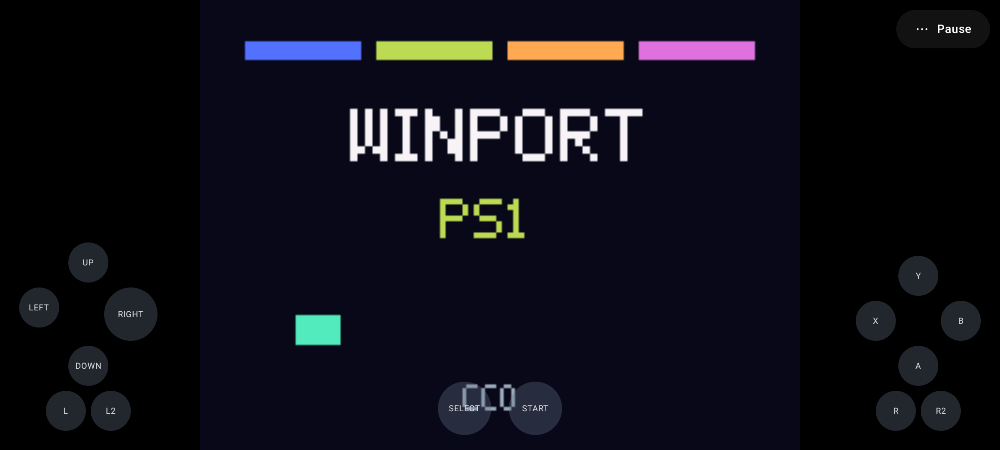

# Winport — PlayStation / libretro frontend

An independent Android console-style launcher with a **Rust libretro frontend**, software video and stereo audio. Step 1 runs an original PS1 homebrew on PCSX ReARMed's HLE BIOS; it is not a general compatibility or performance claim. No games, BIOS or emulator cores are bundled.



## Architecture

```text
ConsoleActivity.kt       Immersive landscape activity, KeyEvent / MotionEvent dispatch
RetroScreen.kt           Console home, runtime core downloads, SAF Open ROM
                        SurfaceView, AudioTrack, virtual pad, pause/state menu
ConsoleKit.kt            Original icons, focus treatment, ambient background
ConsoleOverlays.kt       Control Center and dialogs
                ↓ RetroNative JNI (commands, surface, PCM, input)
rust/src/retro_jni.rs    Single-session command dispatch and exception translation
rust/src/libretro.rs     libloading, libretro callbacks, timing, software pixel conversion
                        ANativeWindow blit, bounded PCM queue, states and SRAM
rust/src/retro_log.c      Variadic libretro logging → Android logcat
```

Core calls and state operations run serially on an emulation thread, not the UI thread. Video supports XRGB8888, RGB565 and 0RGB1555; Rust converts to RGBA and blits to an Android native window. Stereo 16-bit PCM is drained from Rust by a separate AudioTrack thread at the core's reported sample rate. Frame pacing uses the reported FPS. The environment implements directories, legacy variables, v1/v2 core option defaults, logging and input descriptors. Unsupported hardware-rendering/environment features return false; SwanStation's renderer is forced to Software.

Runtime data stays in app-private storage:

```text
files/cores/<abi>/<name>_libretro_android.so
files/system/                                  optional legally supplied BIOS, never downloaded
files/roms/<ROM SHA-256>/<filename>
files/saves/<core SHA-256 prefix>/<ROM SHA-256>/state.bin
                                             /sram.bin
```

States are isolated by the first 96 bits of the downloaded core's SHA-256 and the ROM hash because nightly cores can change serialization formats. State and SRAM writes use temporary-file replacement. SRAM is loaded at startup and saved on a clean Exit; Android killing the process can lose subsequent memory-card changes. Core-managed additional memory cards may also appear in the save directory.

The original Windows/Box64 Rust modules, `NativeCore`/ViewModel and older console forms remain as inactive legacy code and regression tests. **No Windows containers, profiles, components or launch controls are reachable from the active UI.** The current entry is `RetroShell`; full PlayStation library and BIOS-management screens are later work.

## Build (Linux, JDK 17)

Prerequisites: Rust stable, a C compiler, `unzip`, JDK 17 and Android SDK command-line tools. The checked-in wrapper uses Gradle 8.9 / AGP 8.7.3 / Kotlin 2.0.21; minSdk 26, target SDK 35.

```sh
export JAVA_HOME=/usr/lib/jvm/java-17-openjdk-amd64
export ANDROID_HOME="$HOME/android-sdk"
export PATH="$HOME/.cargo/bin:$ANDROID_HOME/cmdline-tools/latest/bin:$ANDROID_HOME/platform-tools:$PATH"
# Install Android command-line tools into $ANDROID_HOME/cmdline-tools/latest first.
sdkmanager --licenses
sdkmanager 'platform-tools' 'platforms;android-35' 'build-tools;35.0.0' 'ndk;27.2.12479018'
export ANDROID_NDK_HOME="$ANDROID_HOME/ndk/27.2.12479018"
rustup target add aarch64-linux-android x86_64-linux-android
cargo install cargo-ndk --version 4.1.2 --locked

cd rust
cargo test --locked
cd ../android
./gradlew assembleDebug --max-workers=2
adb install -r app/build/outputs/apk/debug/app-debug.apk
```

Gradle automatically invokes `scripts/build-rust.sh`: cargo-ndk builds the frontend for **arm64-v8a and x86_64**, API 26, release mode, into ignored `jniLibs` directories. `bash scripts/build-rust.sh` can also be run separately. Downloaded libretro cores are **not** build inputs or APK assets. APK: `android/app/build/outputs/apk/debug/app-debug.apk`. Google's public Maven Central mirror precedes Central because Central returned HTTP 429 in this environment.

## Run a PS1 game

1. Open **Core settings**. SwanStation is the preferred core when you have a compatible legally obtained BIOS. Beetle (`mednafen_psx`) is another option. **Select PCSX ReARMed · HLE for the BIOS-free homebrew check**; it is the initial selection so this test is accessible without BIOS setup.
2. Press **Download core**. Only this user action downloads native code over HTTPS:
   `https://buildbot.libretro.com/nightly/android/latest/<abi>/<core>_libretro_android.so.zip`.
   All three archives were found for both supported ABIs. The downloader extracts only the expected `.so`, limits size, checks ELF magic and stages installation. Existing installs survive download failures. There is no automatic or background core download.
3. Press **Open ROM** and choose a legally obtained single-file PS1 `.exe` (PS-X EXE, not Windows), `.bin`, `.iso`, `.img`, `.chd` or `.pbp` through the system picker. It is copied into private storage. Multi-file CUE/BIN imports are deliberately not supported yet.
4. Use a gamepad's D-pad, A/B/X/Y, shoulders, triggers, Start/Select and analog sticks, or the translucent generic on-screen pad. **Back / Menu / controller Mode** opens Pause; Start remains the emulated game Start button. The pause menu offers Resume, Save state, Load state, Verify state round trip and Exit. Loading before a save reports an error, rather than fabricating a state.
5. Use **Exit** for clean SRAM persistence. From the home screen, Start/Menu or the avatar opens the Control Center; Power → Exit app closes the launcher.

Only load trusted cores: they execute native code with the app's privileges. HTTPS and ELF checks are not signature verification; these nightlies are not pinned. Cores retain their own licenses and requirements. No Sony BIOS is supplied or fetched. SwanStation and Beetle need an appropriate legally supplied BIOS in `files/system`; there is no BIOS picker yet. PCSX ReARMed HLE works for the test below but is not a substitute for full BIOS compatibility.

## Redistributable test ROM

`scripts/make-ps1-demo.py` and its generated output are original **CC0-1.0** material. It emits a small MIPS PS-X EXE directly: original pixel lettering, color bars and an animated square, with no SDK, Sony BIOS, commercial code or external assets. It is a silent demo, not a game compatibility test.

```sh
mkdir -p "$HOME/winport-verification"
python3 scripts/make-ps1-demo.py "$HOME/winport-verification/winport-demo.exe"
adb push "$HOME/winport-verification/winport-demo.exe" /sdcard/Download/
# Then select it using Open ROM in the app.
```

The ROM is generated outside the repository and is not packaged. The screenshot shows pixels produced by the actual PS1 core, not a Compose preview or replacement bitmap.

## Screenshots and verification

Android 15 / API 35 x86_64 emulator, 2400 × 1080 landscape, hidden system bars:

| State | Screenshot |
| --- | --- |
| User-triggered core download completed | [ps1-core-installed.png](docs/ps1-core-installed.png) |
| Original PS1 homebrew running with HLE BIOS | [ps1-homebrew.png](docs/ps1-homebrew.png) |
| Pause menu and successful state replay check | [ps1-state-roundtrip.png](docs/ps1-state-roundtrip.png) |

The in-app round-trip check saves to disk, runs five frames, reloads, replays the same five frames and compares the complete software framebuffer, then restores the starting state again. On the animated demo it reported `restored: true`, `frameAdvanced: true`, `replayMatched: true`, with a 4,456,448-byte state. Run the ROM until video appears before using this diagnostic; it replaces the current state slot.

See [verification notes](docs/verification.md) for command output, runtime core/ROM hashes, save-state checks and limitations. Older `home-*`, settings and Control Center captures in `docs/` document the previous Windows-launcher UI, not the current runtime.

## Scope and limits

- Step 1 is **software-only, single-session PS1**, with a temporary Open ROM flow. No GPU libretro context, Vulkan/OpenGL frontend, full library, BIOS manager, disc switching or multi-file imports yet.
- `dlopen` of a runtime-downloaded `.so` from app-private storage was verified on the API 35 emulator with targetSdk 35. This is not direct execution of an imported ELF executable and does not implement the old Windows launch backend.
- Cores can reject content, require BIOS or crash the process. There is no native-code sandbox, pinned core updater, foreground emulation service or process resurrection. Unsupported state formats and missing states report errors.
- The emulator uses software graphics. Hardware performance, audible output, Bluetooth devices and ARM64 execution remain unverified; both native ABIs compile. The silent test does not prove sound fidelity or gamepad behavior.
- The interface uses the system sans font and original shapes/icons. No Sony logos, controller-button artwork, fonts, sounds or images are included. This project is not affiliated with Sony Interactive Entertainment.
