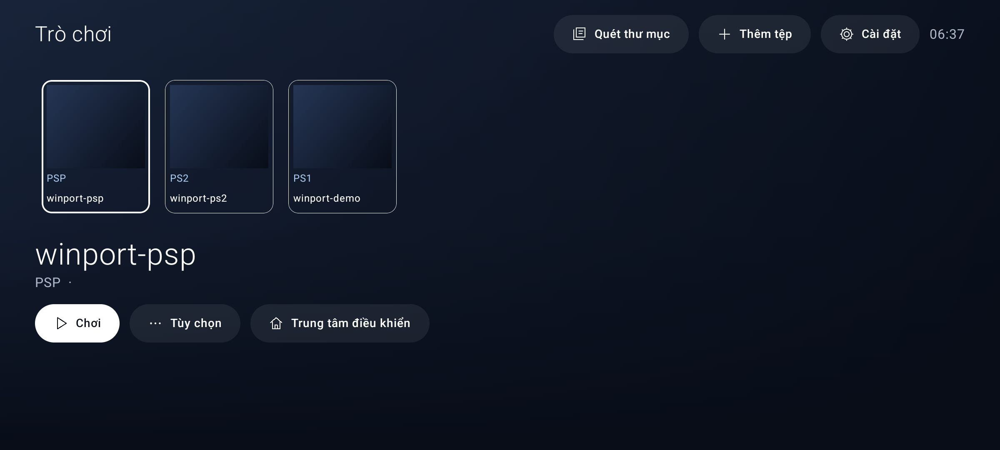

# Winport — PlayStation / libretro frontend

An independent Android console-style launcher with a **Rust libretro frontend**, GLES hardware/software video and stereo audio. Original CC0 homebrew runs through PS1 / PCSX ReARMed HLE, PSP / PPSSPP GLES and PS2 / Play! GLES. These are rendering checks, not broad game-compatibility or performance claims. No games, BIOS, PPSSPP assets or emulator cores are bundled.



## Current app — Step 4

The active interface is Vietnamese, landscape and fullscreen. It starts with an empty library, not demo entries. The files used in the verification screenshots were generated outside the repository and added through Android's document picker.

- **Quét thư mục** grants persistent SAF read access and recursively discovers PS1, PSP, PS2 and PS3 content. Overlapping roots are merged by provider/document identity and size, not the tree URI prefix. **Cài đặt → Thư viện và thư mục** offers rescan/forget. **Thêm tệp** keeps a manual system/title selector for ambiguous formats. Rescanning preserves existing art and does not silently delete missing/offline entries. PS4 is intentionally absent from the UI/library; internal recognition excludes its folders/packages and old entries are hidden/removed.
- Detection and persistence live in Rust (`station.rs`, `disc.rs`). SFO, PS-X EXE, PBP, ELF flags, PKG signatures and ISO directory/SYSTEM.CNF data are parsed with bounded reads; PSP/PS3 ISO SFO titles and serials are read when available. CSO v1 and CHD v5 are decoded only as far as needed for ISO metadata. Older/unsupported images and inconclusive headers are reported rather than confidently assigned the wrong system; add them manually and choose the system. Provider streams without seek support use bounded header/chunk reads for uncompressed content. Core support for any container format is a separate constraint.
- **Tùy chọn** offers user-triggered libretro-thumbnails fuzzy cover lookup, a custom-image picker, title/system editing and removal. Folder scans use available ICON0.PNG/PIC1.PNG art. Images are cached privately and used in tiles and the game hub; no copyrighted example artwork is bundled. Cover lookup requires network access and an available GitHub API quota.
- **Cài đặt → BIOS và firmware** explains each system in Vietnamese, imports user-supplied files and calculates MD5. Known PS1 hashes are checked; mismatches are rejected. Unknown firmware is explicitly unverified, not called valid. PPSSPP and Play! use HLE. PS3 links to Sony's official firmware support page but never downloads firmware. External emulators may need their own firmware import.
- **Cài đặt → Tay cầm và điều khiển** remaps physical keys, analog deadzone, virtual-pad size/opacity and hiding when a controller is connected. PSP/PS2 have two virtual analog sticks. Changes apply to the next session. Pair Bluetooth devices using Android settings.
- In-game **Tạm dừng** has slots 1–4 with thumbnails/timestamps and save/load/delete actions. Optional auto-save uses slot 0. Core state support is not guaranteed: failed/missing states show errors. Use the in-game memory card too, especially for Play!.
- **PS3** uses a selected installed external application, not an in-app core. The app sends ACTION_VIEW with the content URI/read grant and falls back to the package launcher with a toast if unsupported. Folder support and additional SAF grants depend on that external app.
- Sessions run in **`:emu`**, separate from the launcher. Checkpoints write exposed SRAM plus optional auto-state using file fsync, atomic rename and directory fsync. Pause/Stop request the same serialized checkpoint. An automatic teardown deadline is armed **only after a successful checkpoint**, not when Exit is first tapped. Core execution stops before context_destroy (with EGL current), unload, deinit and EGL destruction. Audio callbacks use try-lock/drop rather than waiting for the buffer lock.
- A package-private heartbeat reports native-thread progress. A core call that stops progressing for over five seconds shows a Vietnamese warning and an explicit force-exit option; unsaved data may be lost. **Lossless forced termination/system SIGKILL is not guaranteed.** The pinned Play! binary can block inside retro_run before it services checkpoints and exposes no libretro SRAM. This is a core limitation, not fixed by rearranging teardown. See [Step 4 evidence and concrete limits](docs/step4-verification.md). Process separation is fault isolation, not a native-code security sandbox.
- Cores are pinned by **URL + SHA-256** in `rust/core-manifest.json`; both downloads and launch verify the extracted ELF and fail closed. The inspected stable Android directories exposed APKs, not versioned individual cores; tested dated/versioned core URLs returned 404. These pins therefore use mutable nightly URLs with fixed observed hashes. Refresh deliberately with `bash scripts/update-core-hashes.sh`, review the manifest diff and rebuild; an upstream nightly change otherwise results in a clear hash error. No automatic hash refresh or unverified fallback is used.

Generate the verification folder (original CC0 executables plus synthetic unsupported-system metadata used to test exclusion; no BIOS or commercial game):

```sh
mkdir -p "$HOME/winport-verification/step3-scan"
python3 scripts/make-step3-fixture.py "$HOME/winport-verification/step3-scan"
adb push "$HOME/winport-verification/step3-scan" /sdcard/Download/
# In the app: Quét thư mục → Download/step3-scan → USE THIS FOLDER → ALLOW.
```

Current evidence: [Step 4 checks](docs/step4-verification.md). [Step 3 verification](docs/step3-verification.md) is historical and shows the former system visibility/exit behavior.

GitHub Actions (`.github/workflows/ci.yml`) runs locked Rust tests and builds both Android ABIs with JDK 17/NDK 27, then uploads the debug APK. No LICENSE file is supplied; no project-wide license is granted by this repository. Existing third-party and generated homebrew notices retain their own scope.

## Architecture

```text
ConsoleActivity.kt       Immersive landscape activity, KeyEvent / MotionEvent dispatch
StationScreen/Data.kt    Vietnamese library, SAF, art, firmware and external-app setup
StationControls.kt       Physical mappings and virtual analog controls
EmuActivity.kt           Separate :emu process; bounded Exit / fault isolation
RetroScreen.kt           Runtime core downloads,
                        SurfaceView, AudioTrack, virtual pad, pause/state menu
ConsoleKit.kt            Original icons, focus treatment, ambient background
ConsoleOverlays.kt       Control Center and dialogs
                ↓ RetroNative JNI (commands, surface, PCM, input)
rust/src/retro_jni.rs    Single-session command dispatch and exception translation
rust/src/libretro.rs     libloading, libretro callbacks, timing, software pixel conversion
                        ANativeWindow blit, bounded PCM queue, states and SRAM
rust/src/retro_log.c      Variadic libretro logging → Android logcat
rust/src/retro_hw.rs      Hardware callback ABI, run-thread context/surface lifecycle
rust/src/retro_gl.c       EGL/GLES3 context, color/depth/stencil FBO and window blit
rust/src/station.rs      Library persistence, SFO/boot parsing, fuzzy art/MD5 lists
rust/src/disc.rs         Random-access CSO/CHD metadata decoding
```

Core calls and state operations run serially on an emulation thread, not the UI thread. Software video supports XRGB8888, RGB565 and 0RGB1555; Rust converts to RGBA and blits to an Android native window. Hardware cores get an EGL context and frontend FBO on that same thread, proc/framebuffer callbacks, context reset/destroy notifications and aspect-correct window presentation, including bottom-left origin. Surface replacement destroys/recreates the context. ES2 requests are served with a compatible ES3 context; an ES3-capable device is required. Desktop OpenGL and Vulkan requests are rejected.

Stereo 16-bit PCM is drained from Rust by a separate AudioTrack thread at the core's reported sample rate. Software and hardware frame pacing use the reported FPS, including AV-info updates. The environment implements directories, legacy variables, v1/v2 core option defaults, logging, input descriptors, preferred GLES rendering and geometry/AV changes. SwanStation remains forced to Software for the PS1 path.

Runtime data stays in app-private storage:

```text
files/cores/<abi>/<name>_libretro_android.so
files/system/                                  optional legally supplied BIOS, never downloaded
             PPSSPP/                           user-triggered PPSSPP assets, including licenses
files/roms/<ROM SHA-256>/<filename>
files/saves/<core SHA-256 prefix>/<ROM SHA-256>/slot-0.state ... slot-4.state
                                             /slot-N.png
                                             /sram.bin
files/station.json                              systems, content URIs, folders, preferences
files/art/                                      cached/custom images
```

States are isolated by the first 96 bits of the downloaded core's SHA-256 and the single-file ROM hash because nightly cores can change serialization formats. CUE/M3U use a hash of their URI-specific staging path so identical descriptors from different games do not share state/SRAM. State and SRAM writes use temporary-file replacement. SRAM is loaded at startup and saved on a clean Exit; Android killing the process can lose subsequent memory-card changes. Core-managed additional memory cards may also appear in the save directory.

The original Windows/Box64 Rust modules, `NativeCore`/ViewModel and older console forms remain as inactive legacy code and regression tests. **No Windows containers, profiles, components or launch controls are reachable from the active UI.** The current entry is `StationShell`.

## Build (Linux, JDK 17)

Prerequisites: Rust stable, a C compiler, `unzip`, JDK 17 and Android SDK command-line tools. The checked-in wrapper uses Gradle 8.9 / AGP 8.7.3 / Kotlin 2.0.21; minSdk 26, target SDK 35.

```sh
export JAVA_HOME=/usr/lib/jvm/java-17-openjdk-amd64
export ANDROID_HOME="$HOME/android-sdk"
export PATH="$HOME/.cargo/bin:$ANDROID_HOME/cmdline-tools/latest/bin:$ANDROID_HOME/platform-tools:$PATH"
# Install Android command-line tools into $ANDROID_HOME/cmdline-tools/latest first.
sdkmanager --licenses
sdkmanager 'platform-tools' 'platforms;android-35' 'build-tools;35.0.0' 'ndk;27.2.12479018'
export ANDROID_NDK_HOME="$ANDROID_HOME/ndk/27.2.12479018"
rustup target add aarch64-linux-android x86_64-linux-android
cargo install cargo-ndk --version 4.1.2 --locked

cd rust
cargo test --locked
cd ../android
./gradlew assembleDebug --max-workers=2
adb install -r app/build/outputs/apk/debug/app-debug.apk
```

Gradle automatically invokes `scripts/build-rust.sh`: cargo-ndk builds the frontend for **arm64-v8a and x86_64**, API 26, release mode, into ignored `jniLibs` directories. `bash scripts/build-rust.sh` can also be run separately. Downloaded libretro cores are **not** build inputs or APK assets. APK: `android/app/build/outputs/apk/debug/app-debug.apk`. Google's public Maven Central mirror precedes Central because Central returned HTTP 429 in this environment.

## Original Step 1 core verification (historical UI labels)

For the current app use **Cài đặt → Lõi giả lập** to download a core, then scan/add content as above. Scanned CUE/M3U sets are now staged recursively with their dependencies; a standalone manual CUE/M3U requires folder access. The following records the earlier single-ROM proof, not the current navigation labels.

1. Open **Core settings**. SwanStation is the preferred core when you have a compatible legally obtained BIOS. Beetle (`mednafen_psx`) is another option. **Select PCSX ReARMed · HLE for the BIOS-free homebrew check**; it is the initial selection so this test is accessible without BIOS setup.
2. Press **Download core**. Only this user action downloads native code over HTTPS:
   `https://buildbot.libretro.com/nightly/android/latest/<abi>/<core>_libretro_android.so.zip`.
   All three archives were found for both supported ABIs. The downloader extracts only the expected `.so`, limits size, checks ELF magic and stages installation. Existing installs survive download failures. There is no automatic or background core download.
3. Press **Open ROM** and choose a legally obtained single-file PS1 `.exe` (PS-X EXE, not Windows), `.bin`, `.iso`, `.img`, `.chd` or `.pbp` through the system picker. It is copied into private storage. Multi-file CUE/BIN imports are deliberately not supported yet.
4. Use a gamepad's D-pad, A/B/X/Y, shoulders, triggers, Start/Select and analog sticks, or the translucent generic on-screen pad. **Back / Menu / controller Mode** opens Pause; Start remains the emulated game Start button. The pause menu offers Resume, Save state, Load state, Verify state round trip and Exit. Loading before a save reports an error, rather than fabricating a state.
5. Use **Exit** for clean SRAM persistence. From the home screen, Start/Menu or the avatar opens the Control Center; Power → Exit app closes the launcher.

Only load trusted cores: they execute native code with the app's privileges. Step 4 now pins the nightly ELF hashes; this is integrity checking, not an upstream digital signature or sandbox. Cores retain their own licenses and requirements. No Sony BIOS is supplied or fetched. SwanStation and Beetle need an appropriate legally supplied BIOS in `files/system`; the current BIOS settings page provides an import picker. PCSX ReARMed HLE works for the test below but is not a substitute for full BIOS compatibility.

## PSP and PS2

The same **Core settings** screen offers **PSP · PPSSPP** (`ppsspp`) and **PS2 · Play!** (`play`). Both archives exist for `arm64-v8a` and `x86_64` at the nightly URL above. `pcsx2_libretro_android.so.zip` also exists for both ABIs, but is not offered or runtime-tested here; no `lrps2_libretro_android.so.zip` was present in either listing. Archive presence is not a compatibility claim.

- **PPSSPP:** Download core also fetches `https://buildbot.libretro.com/assets/system/PPSSPP.zip`. Its PPSSPP assets and open replacement fonts are extracted under `files/system/PPSSPP`, including `flash0/font`, with the archive's licenses retained. These are not Sony BIOS files. Extraction bounds entries/uncompressed bytes, rejects traversal and stages replacement before installation. Subsequent core downloads reuse a completed asset installation. PSP imports accept `.elf`, `.iso`, `.cso`, `.prx` and `.pbp`.
- For folder-based PSP homebrew, use **Quét thư mục**, not a single-file import. Keep `EBOOT.PBP` beside its data directories (for example `PSP/GAME/<game>/EBOOT.PBP` with `ID1/`, game data and music); choose the whole game folder or its parent in the SAF picker, not just `SLIM EBOOT/`. Launch recopies the full game folder into app-private storage, verifies every file's declared size and rechecks the source before replacing the previous staging. The selected alternate `SLIM EBOOT/EBOOT.PBP` is staged as the main EBOOT beside the shared data; neighboring game folders are excluded. If copying or verification fails, launch is blocked and an error is shown. Embedded PBP titles and ICON0 artwork are read during scanning.
- **Play!:** Uses PS2 BIOS HLE, not an external Sony BIOS. Provide legal PS2 content; no BIOS, disc or proprietary firmware is fetched. The Android build's legacy `EXTERNAL_STORAGE` data location is redirected to its app-private save directory. Its exported `Framework::CJavaVM::SetJavaVM` hook, when present, receives the app VM before initialization: direct `dlopen` does not perform Java library initialization. This is a Play!-specific Android compatibility bridge, not part of the libretro ABI, and may need revision for future nightlies. Single-file `.elf`, `.iso`, `.cso`, `.isz` and `.chd` are accepted. The core also advertises CUE; the app can stage scanned CUE/BIN dependencies, but only the generated ELF was run here.

Generate the original CC0 PSP/PS2 tests without a proprietary SDK:

```sh
mkdir -p "$HOME/winport-tests"
python3 scripts/make-hw-demos.py "$HOME/winport-tests"
adb push "$HOME/winport-tests/winport-psp.elf" /sdcard/Download/
adb push "$HOME/winport-tests/winport-ps2.elf" /sdcard/Download/
```

The system on each library entry now selects PSP/PS2 automatically; the PS1 core preference is persisted. PSP writes original VRAM pixels and uses HLE display imports; PS2 emits original GIF/GS sprites. Neither contains BIOS or commercial game material. Their execution status and native-core limitations are recorded in [verification notes](docs/verification.md).

## Redistributable test ROM

`scripts/make-ps1-demo.py` and its generated output are original **CC0-1.0** material. It emits a small MIPS PS-X EXE directly: original pixel lettering, color bars and an animated square, with no SDK, Sony BIOS, commercial code or external assets. It is a silent demo, not a game compatibility test.

```sh
mkdir -p "$HOME/winport-verification"
python3 scripts/make-ps1-demo.py "$HOME/winport-verification/winport-demo.exe"
adb push "$HOME/winport-verification/winport-demo.exe" /sdcard/Download/
# Then select it using Open ROM in the app.
```

The ROM is generated outside the repository and is not packaged. The screenshot shows pixels produced by the actual PS1 core, not a Compose preview or replacement bitmap.

## Screenshots and verification

Android 15 / API 35 x86_64 emulator, 2400 × 1080 landscape, hidden system bars:

| State | Screenshot |
| --- | --- |
| User-triggered core download completed | [ps1-core-installed.png](docs/ps1-core-installed.png) |
| Original PS1 homebrew running with HLE BIOS | [ps1-homebrew.png](docs/ps1-homebrew.png) |
| Pause menu and successful state replay check | [ps1-state-roundtrip.png](docs/ps1-state-roundtrip.png) |
| PPSSPP downloaded with runtime assets | [psp-core-installed.png](docs/psp-core-installed.png) |
| Original PSP homebrew through GLES | [psp-homebrew.png](docs/psp-homebrew.png) |
| PSP restored after EGL/surface recreation | [psp-surface-recreated.png](docs/psp-surface-recreated.png) |
| Play! runtime core installed | [ps2-core-installed.png](docs/ps2-core-installed.png) |
| Original PS2 GS-sprite homebrew through GLES | [ps2-homebrew.png](docs/ps2-homebrew.png) |
| PS1 software-path regression after GLES support | [ps1-step2-regression.png](docs/ps1-step2-regression.png) |

The in-app round-trip check saves to disk, runs five frames, reloads, replays the same five frames and compares the complete software framebuffer, then restores the starting state again. On the animated demo it reported `restored: true`, `frameAdvanced: true`, `replayMatched: true`, with a 4,456,448-byte state. Run the ROM until video appears before using this diagnostic; it replaces the current state slot.

See [verification notes](docs/verification.md) for command output, runtime core/ROM hashes, save-state checks and limitations. Older `home-*`, settings and Control Center captures in `docs/` document the previous Windows-launcher UI, not the current runtime.

## Scope and limits

- Single-session software PS1 / GLES PSP and PS2 frontend. No Vulkan, desktop OpenGL or in-session disc switching. Save-state framebuffer replay verification is software-only, not a hardware readback test. Header detection is bounded and deliberately reports ambiguity rather than promising support for every disc/container variant.
- `dlopen` of a runtime-downloaded `.so` from app-private storage was verified on the API 35 emulator with targetSdk 35. This is not direct execution of an imported ELF executable and does not implement the old Windows launch backend.
- Cores can reject content, require BIOS or crash the process. There is no native-code sandbox, pinned core updater, foreground emulation service or process resurrection. Unsupported state formats and missing states report errors.
- The tested Play! nightly still stalls inside the native session; Step 3 isolates it in `:emu` and terminates that process on Exit without killing the launcher. Native shutdown/state/SRAM completion is not guaranteed for Play!. The exact native blocking call remains unverified. Play!'s original Android initialization failures and the VM/storage bridge are documented in the verification notes.
- The emulator executes GLES through SwiftShader, not a physical GPU. Device performance, audible output, Bluetooth devices and ARM64 execution remain unverified; both native ABIs compile. The silent tests do not prove sound fidelity or gamepad behavior.
- The interface uses the system sans font and original shapes/icons. No Sony logos, controller-button artwork, fonts, sounds or images are included. This project is not affiliated with Sony Interactive Entertainment.
