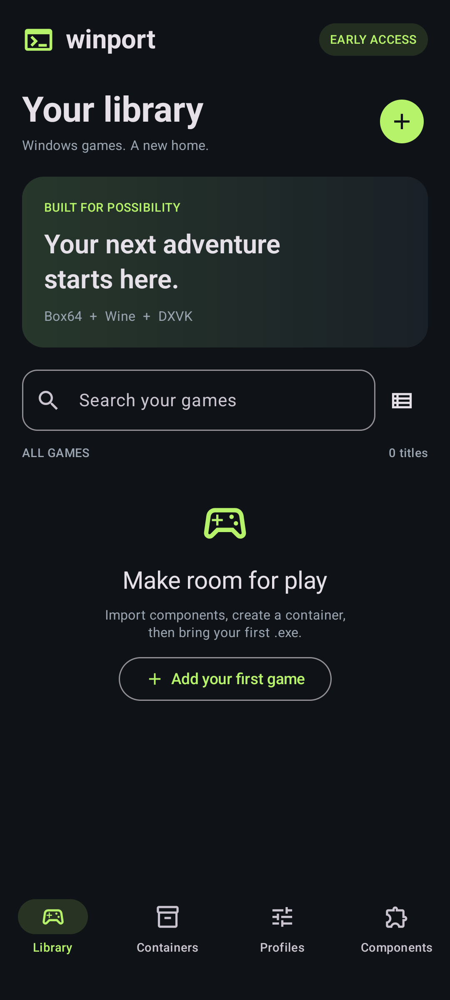

# Winport

A small, buildable **Winlator-style launcher scaffold**: Kotlin / Jetpack Compose on Android, with a Rust core behind a JSON JNI boundary. Dark Material 3 UI, local game library, Wine prefix containers, editable performance presets and user-imported runtime components.



**This is not yet a working Windows runtime on modern Android.** The launcher builds and packages a real Rust native library; it does not bundle or silently download Box64, Wine, DXVK or a Linux rootfs. No games are included.

## Architecture

```
android/app/.../MainActivity.kt     Library grid/list + bottom navigation
             Editors.kt           Game and performance editors
             ManagementScreens.kt Containers, Profiles, Components
             CoreViewModel.kt     Async JNI calls and Android SAF stream copying
             NativeCore.kt        Serializable view models + JSON bridge
                            ↓ JNI: NativeCore.call(method, JSON) → JSON
rust/src/lib.rs                   Core, validated CRUD, process ownership
         storage.rs               Atomic JSON snapshot replacement
         components.rs            Staged archive import and registry
         containers.rs            Wine prefix metadata
         profiles.rs              Performance / Balanced / Compatibility
         library.rs               Game metadata
         launch.rs                Pure launch plan, spawn and stop
         jni.rs                   Mutex-protected core, exception translation
```

Domain state, validation, archive extraction, presets, launch environment/argv and process control live in Rust. Kotlin owns UI presentation and the Android-only SAF file transport. Disk-heavy work and JNI calls run off the main thread. Persistence lives in `files/core/state.json`; prefixes and components are siblings beneath that directory. There is no network permission or backend.

## Build (Linux, JDK 17)

Prerequisites: Rust stable, a C toolchain, `unzip`, JDK 17, Android SDK command-line tools. The checked-in Gradle wrapper uses Gradle 8.9 / AGP 8.7.3 / Kotlin 2.0.21. The application targets SDK 35 and supports API 26+.

```sh
export JAVA_HOME=/usr/lib/jvm/java-17-openjdk-amd64
export ANDROID_HOME="$HOME/android-sdk"
export PATH="$HOME/.cargo/bin:$ANDROID_HOME/cmdline-tools/latest/bin:$ANDROID_HOME/platform-tools:$PATH"
# Download Android command-line tools from developer.android.com/studio#command-tools
# and extract them to $ANDROID_HOME/cmdline-tools/latest first.
sdkmanager --licenses
sdkmanager 'platform-tools' 'platforms;android-35' 'build-tools;35.0.0' 'ndk;27.2.12479018'
export ANDROID_NDK_HOME="$ANDROID_HOME/ndk/27.2.12479018"
rustup target add aarch64-linux-android x86_64-linux-android
cargo install cargo-ndk --version 4.1.2 --locked

cd rust
cargo test --locked
cd ..
bash scripts/build-rust.sh
cd android
./gradlew assembleDebug
unzip -l app/build/outputs/apk/debug/app-debug.apk | rg libwinport_core.so
adb install -r app/build/outputs/apk/debug/app-debug.apk
```

`assembleDebug` automatically runs `:app:buildRust`, invoking cargo-ndk for **arm64-v8a and x86_64**, API 26, release mode. Output goes to `android/app/src/main/jniLibs/<abi>/libwinport_core.so` and is ignored by Git. To build only arm64 manually:

```sh
cd rust
cargo ndk -t arm64-v8a --platform 26 -o ../android/app/src/main/jniLibs build --release --locked
```

The APK is `android/app/build/outputs/apk/debug/app-debug.apk`. Use environment variables above (or Android Studio's `local.properties` for the SDK); no machine-specific SDK path is committed. Google's public Maven Central mirror precedes Maven Central because the latter returned HTTP 429 in the build environment. Add these SDK/NDK/JDK and Rust targets to your Devin environment blueprint to avoid reinstalling in a future session.

## Use

1. **Components:** choose a kind and import a trusted `.tar.xz`, `.tar.gz` or `.zip` through the Android file picker. The content URI is copied to a private temporary cache directory, extracted by Rust into staging, then renamed into place. Failed imports remove staging and leave the registry unchanged.
2. **Containers:** select an imported Wine version and create a named prefix. Creating a container makes the directory, **not a fully initialized Wine installation**.
3. **Library → +:** select the container and profile. Choose a `.exe` with SAF (extension checked after selection because providers do not agree on an EXE MIME type), or enter an existing container-relative path. An imported EXE is copied to `drive_c/imports/<uuid>/filename.exe`. Importing an EXE alone does **not** copy its adjacent DLLs/assets; place a complete game tree in the prefix separately.
4. Extra arguments are one argument per line. Paths and arguments containing spaces stay individual argv entries; no shell is involved. Save and reopen a game to preview the saved launch plan, environment and CPU affinity.
5. Profiles expose Box64 big-block / strong-memory / safe-flags controls, DXVK HUD, FPS limit (0 = unlimited), resolution and comma-separated CPU cores (blank = OS default). They are editable; presets are created only on first initialization.
6. Launch reports a PID if spawning succeeds; Stop only accepts a process owned by the current core session, kills its process group and reaps it. Running indicators are session-local and are cleared with Stop; they are not a live process monitor.

Container and component deletion is permanent and asks for confirmation. A Wine component referenced by a container, a container referenced by a game, or a profile referenced by a game cannot be removed. Removing a game only removes its library metadata, not its files.

### Archive layout and selection

The archive **basename** is its version, e.g. `wine-9.0.tar.xz` → `components/wine/wine-9.0/`. Only ASCII letters, numbers, `.`, `_`, `-` are allowed in basenames. Duplicate kind/version directories are rejected rather than overwritten. The archive must contain the following paths directly (no extra top-level directory):

| Kind | Expected content |
| --- | --- |
| Box64 | `bin/box64` (ARM64 Linux build, not bundled) |
| Wine | `bin/wine` and its matching Wine installation |
| Dxvk | `x64/*.dll` |
| Rootfs | `lib/x86_64-linux-gnu/`, `usr/lib/x86_64-linux-gnu/`, loader and required system files |

Containers pin a Wine component ID. Other kinds use the **first installed** component of that kind. Import is a registry operation, not binary compatibility validation. Archives with symlinks, hardlinks or special files are deliberately rejected, and traversal/absolute paths are rejected. Most distribution rootfs archives contain links: prepare a flattened, regular-file-only archive first. ZIP executable modes are preserved when present; use tar for reliable Unix permissions. Imports are not size-quota limited: only import trusted archives and check free space. Runtime binaries are untrusted native code and are not sandboxed beyond Android's app sandbox.

## JSON JNI API

`object NativeCore` loads `winport_core`; `external fun call(method: String, payload: String): String` is the only native entry point. Call `init` with `{"data_dir":"/absolute/private/path"}` once. JNI failures throw `IllegalStateException` with a readable Rust error; calls must not assume an `{"error":...}` return. A mutex serializes operations and all mutations persist before returning success.

| Method | Payload / result |
| --- | --- |
| `snapshot` | `{}` → components, containers, profiles, games |
| `listGames`, `listProfiles`, `listContainers`, `listComponents` | `{}` → JSON array |
| `addGame`, `updateGame` | Full Game object; add ignores supplied id and creates UUID |
| `addProfile`, `updateProfile` | Full Profile object; add creates UUID |
| `addContainer`, `updateContainer` | `name`, `wine_component`; update also requires `id`; Rust owns dir |
| `installComponent` | `archive_path`, `kind` (`Box64`, `Wine`, `Dxvk`, `Rootfs`) → Component |
| `updateComponent` | Full Component object; only display version is mutable, not id/path/kind |
| `removeGame`, `removeProfile`, `removeContainer`, `removeComponent` | `id` |
| `buildLaunchPlan` | `id` (saved game) → `env`, `argv`, `cwd`, `cpu_cores` |
| `launch` | `id` → `{"pid":1234}` |
| `stop` | `pid` → `{}` |

Model fields are defined in `rust/src/{library,profiles,containers,components}.rs`. Missing components fail clearly, even during preview. The plan function is pure and intentionally does not require binaries to exist on the machine doing the preview.

## Honest limits / next steps

- **Android 10+ W^X / SELinux prevents direct exec of binaries from writable app data** for modern-target apps. Current `spawn` is a diagnostic direct-execution backend; it is not a workaround. Real launch needs a packaged, policy-compliant **proot / ld-linux loader approach like Winlator**, native ABI handling, rootfs mappings and careful lifecycle management. Rootfs metadata and library search paths alone do not implement that backend.
- No X11/Wayland display server, Vulkan/Turnip/Mesa integration, audio server, controller mapping or Wine prefix bootstrap is included. DXVK paths and DLL override hints are generated, but **DXVK DLL deployment and Wine configuration still need implementation**. On-device rendering will not work merely by importing components.
- Box64 runs x86-64 Linux code on ARM64; building this UI for an x86_64 emulator verifies the launcher/JNI, not ARM emulation or Windows game compatibility. 32-bit x86/WoW64 is not implemented.
- There is no durable Android foreground service, process resurrection, live exit observer or runtime log viewer. Stop is scoped to this app process; Android can terminate it.
- No component signature verification, updater, migration framework, launch sandbox or import disk quota yet. Back up data before experimenting. JSON corruption is reported instead of being silently replaced.
- **AAA games are unlikely to run well**, even after a complete backend: translation overhead, GPU drivers, memory pressure, anti-cheat/DRM and thermal throttling remain major constraints. No performance or compatibility claims are made.

## Verification

Rust tests exercise launch argv/environment, empty arguments, all four missing-component errors, invalid settings and traversal paths, persistence round-trip and corrupt state, staged ZIP import, unsafe ZIP rejection, container directories/deletion guards and PID ownership. `docs/verification.md` records the actual build results for this checkout. An emulator screenshot, if captured, is `docs/screenshot.png`; it verifies the launcher surface, not Windows execution.
